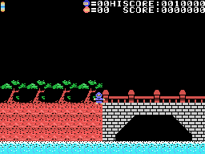
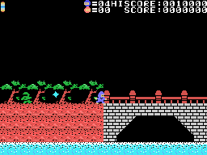

# Curiosities

## Two cartridges at once

Right after power-on, the game looks in every slot (the four and the sixteen expanded ones) for a 0x21 at address
0x81B9 (`init`, 0x4010). That is the byte **the first Iga Ninpouchou**, from 1985, has there, and none of the other
ten Casio games of this series disassembled before. If it finds it, it sets 0xE060 = 1. In openMSX, with the first
Iga in the second slot, 0xE060 becomes 1. What changes:

- **the moon never changes** (0x8862): a fixed drawing (0x890A) takes its place and the stage has no time limit;
- on stage 0 the ninja starts down below, on the river bank (Y 0xA0, not 0x70);
- and stage 0 ends without defeating ten enemies: being at the height of the bridge past position 0x48 of the map is
  enough (0xA7E6). This is read from the code: the pilot of the recording did not get there.

## Two keys on the title

When the CASIO intro ends, the game looks at the keys once (0x809C):

- **BS** held: 0xE023 = 1, and the enemies do not kill the ninja (`ninja_tocado`, 0x850C). The spikes, the moon and
  the boss up close do: those deaths carry a 2 and do not look at BS. In openMSX, with BS, the pilot cleared stage 0
  without losing a life.
- **2, A, I and G** together: 0xE039 = 2, and with no lives left CONTINUE PUSH TRIG1 / END PUSH TRIG2 appears: with
  button 1, **two more lives** and the stage again, as many times as wanted. In openMSX, twice in a row.

## IGA2

When the boss of stage 6 is beaten, the game writes **IGA2** in the tower window (0xAC4D): the same four keys of the
continue trick.

## STOP and F1

While playing, the interrupt looks at two more keys (0x8D0B):

- **STOP** stops the game (0xE1B7): the ninja is drawn with other sprites (0x5400) and nothing moves until it is
  pressed again. With **C and W** held together, other drawings, which go back to the previous ones every 0x60 frames.
- **F1**: the ninja falls and a life is lost (0xE1B3), as when an enemy touches him.

Both checked in openMSX.

## The title colours come from the BIOS

The game's name changes colours every 4 frames: each time it copies 512 bytes **from the computer's ROM**, from 0x3000
and one byte further each time, and uses the high half of each one as a colour, or 0x60 if it is below 0x20 (0x8144).
The colours therefore depend on the MSX's BIOS: the ones in the title GIF are C-BIOS's, openMSX's.

## One life at 10,000

At 10,000 points (1,000 inside: the final 0 is fixed) the game gives one more ninja, only once (0x8C2F).

## SCORE is inside HISCORE

The scoreboard writes "HISCORE:" from 0x9073 and "SCORE:" from 0x9075: the last six letters of the same text
(`marcador_pon`, 0x87A5).

## Leftovers from other programs

- 0x9FD5: the start of the routine of the kakejiku that rolls up, **from the first Iga Ninpouchou**.
- 0xBFBB: the end of the first Iga's routine that paints the screen.
- 0x90D4: a piece of a points routine with a cap at 999999 and one more life when 0xE00D reaches 0x30, which is not
  this game's.

## Code nobody calls

- 0x9A66 and 0x9B02: moving the screen up or down 8 points per step, from one floor to another: a vertical scroll the
  game does not use.
- 0x8A02: another way of opening the screen, from the centre.
- 0x8930, 0x9C5A, 0x9D63, 0xA049, 0xA0A0, 0xA716 and 0xA78F: pieces of routines that are already somewhere else.
- 0x8506: a byte skipped by a `jr`.

None of them ran in the coverage measured in openMSX.
