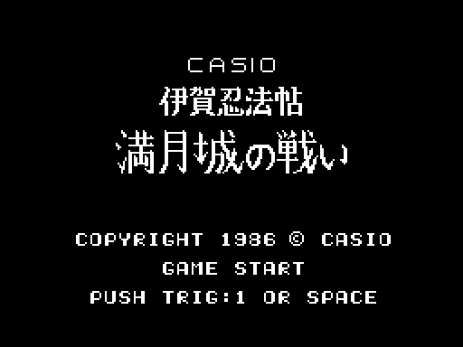
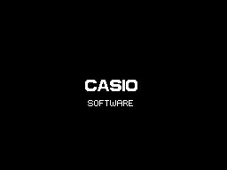
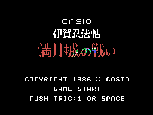
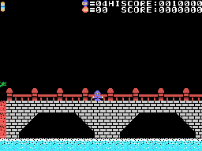
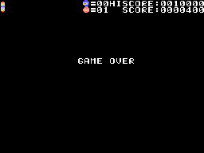

# The game

*Iga Ninpouchou Mangetsu-jou no Tatakai* (伊賀忍法帖 満月城の戦い, "The battle of the full moon castle") is a game about
an Iga ninja seen from the side. The ninja crosses a bridge, gets into the castle and climbs to its tower, where a
boss waits. There are seven stages and three rounds; all of that, in [The stages](THE-STAGES.html).

Every GIF on this site is the ROM **running in openMSX** (a Japanese MSX1 with C-BIOS, at 60 frames per second): on
every frame the VRAM, the RAM and the VDP registers are logged, and `tools/vdp.py` paints them. The game ones come from
simple pilots written for the purpose (`tools/guiones/`).

## The CASIO intro

Two CASIO logos come in from the sides and two more go down and up towards the centre; when they meet, a short tune
plays and SOFTWARE appears below (`presentacion`, 0x8E24).

## The title

CASIO, the name in drawn tiles, COPYRIGHT 1986 © CASIO, GAME START and PUSH TRIG:1 OR SPACE (`titulo`, 0x808D). Every 4
frames the colours of the name change: they come from the computer's BIOS ([Curiosities](CURIOSITIES.html)). With no
button, after 240 frames the **demo** starts, on stage 0: the game presses both buttons every 16 frames and does not
move the stick, until it loses its five lives.

## The controls

| | joystick | keyboard |
|---|---|---|
| walk, crouch; the diagonals go up and down stairs | joystick 1 | the cursors |
| throw the shuriken | button 1 | the space bar |
| jump | button 2 | GRAPH |

There are more keys: BS and 2, A, I and G on the title, and STOP and F1 while playing ([Curiosities](CURIOSITIES.html)).

## The shuriken and the jump

There is **one shuriken** at a time: it leaves at the ninja's height towards where he faces and moves 4 points per
frame up to the edge (`shuriken`, 0x9100). The jump goes up 24 steps and down as many; with the stick to one side it
jumps diagonally, and without it, straight up (`salto`, 0x98F3). Touching an enemy in the middle of a diagonal jump
defeats it.

## The moon

The moon at the top of the scoreboard is **the stage's time** (`luna`, 0x8862). Every so often it changes: it waxes in
four steps up to full, waits one more step and wanes in four more. When it is gone, the ninja dies. Each step lasts 5
times 240 frames on the first round, 4 on the second and 3 on the third: about three minutes per stage on the first
round and under two on the third (in openMSX, 720 frames per step on the third). The fuller the moon, the more often
the enemies come out.

## The lives

The game starts with **five ninjas**, four in reserve next to the ninja icon. If he touches an enemy or what they
throw, or falls on the spikes, the ninja goes up and falls and **the stage starts again** (`ninja_tocado`, 0x850C): on
stages 0 and 1, from the screen he was on; from stage 2, from the first one. The stage RAM is cleared, and with it the
defeated count and the moon. At 10,000 points, one more ninja, only once. With no ninjas left, GAME OVER (`game_over`,
0x8607).

## The scoreboard

At the top: one mark per stage (on the left), the moon, the marks of 0xE053, the ninja with the lives, the enemy with
the defeated count, HISCORE and SCORE (`marcador_pon`, 0x87A5). As in other Casio games, the scoreboard puts **a fixed
0** after the six digits: the figures on this site are the ones on screen.

| | points |
|---|---:|
| an enemy ninja | its type x 100: 100, 300 or 600 |
| the still enemy of stage 1 (five shuriken) | 500 |
| object 0x73 | 500 |
| the castle gate (stages 0 and 1) | 1,000 |
| the exit (stages 2 to 5) | 2,000 |
| the boss | 3,000 |

The high score starts at 0010000.
