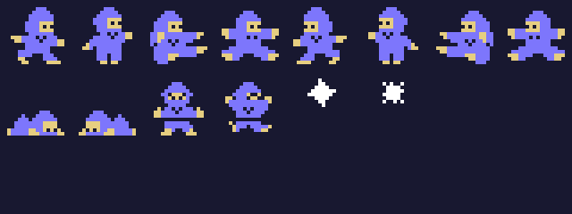
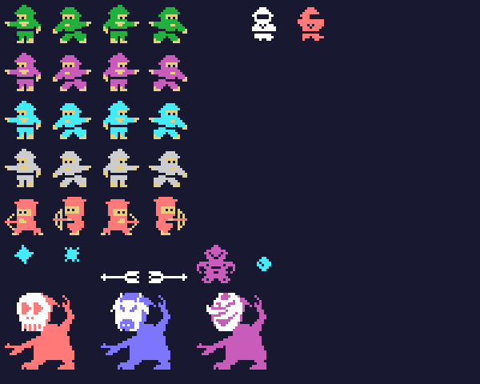
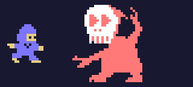

# The sprites

Everything on this page is **put together from the ROM tables** with `tools/hojas.py`: the drawings are the 0x800
bytes at 0x5800 that `sprites_dibujos` puts as they are at 0x3800, and every figure is built with the drawings,
colours and places its own routine gives it. Each thing is made of 16-byte sprites at 0xE300 (the first 4, its
attributes): the ninja at 0xE300 and 0xE310, his shuriken at 0xE320 and the rest from 0xE330. None of these images
is a screenshot.

**Checked against openMSX** on the recordings of this site:

- the sprite drawing table (VRAM 0x3800-0x3FFF) is **identical** to the game's on 102,952 frames (7 more catch the
  copy halfway);
- the ninja's two sprites match on 76,679 frames (432 more are still at zero when a stage starts); **3 unexplained**;
- the enemy ninja (types 1, 3 and 6 and the slot after them) on 60,362 frames; **9 unexplained**;
- the boss on 12,491 frames, and stunned and shaking (or coming out without a drawing yet) on 153; **0 different**.

## The ninja

Two sprites in the same place: the drawing in light blue (5) and the drawing + 4 in light yellow (11)
(`fase_empieza`, 0x829E). Facing right 0x28 or 0x30 (standing, by the column of the map; walking, the step every
8 frames), facing left 0x00 or 0x08 (`ninja_dibujo`, 0x973F); jumping 0x38 and 0x10 and falling 0x40 and 0x18
(0x9701); then crouching (0x48 to the right, 0x20 to the left, 0x96EF) and hit (0x88 and 0x90, 0x8570); and his
shuriken (0xA4 and 0xA8, white):

## The enemies

The enemy ninja are two sprites as well: 0x50 facing left or 0x60 facing right (`ninja_enemigo_dibujo`, 0xA215),
+ 8 with the step, in their colour, and the drawing + 4 in light yellow (`ninja_enemigo_color`, 0xA151). Type 1 is
dark green on stage 0 and magenta after it; type 3, cyan on stage 1 and grey after it; type 6, light red, with a bow
and its own drawings (0xC0 and 0xD0). Knocked down, 0x88 and 0x90,
the same as the hit ninja. Then what they throw (types 2 and 7, `tiro_enemigo`: the stars 0xA4 and 0xA8 in cyan,
the arrows 0x78 and 0x7C in white), type 4 (0x70, magenta, `enemigo4`) and what falls (types 5 and 10, 0x9C in
cyan, `cae_enemigo`). At the bottom, the boss of stage 6 (`jefe`, 0xA99D): five sprites, the head (0xAC, 0xB8 or 0xBC
by the round, in white) 4 dots to the right of the body, two by two in the colour of the round (light red, light
blue or magenta), which changes between 0xF0-0xFC and 0xE0-0xEC every 8 frames (`jefe_dibujo`, 0xAC0F):

The ninja walking and the boss moving, at the game's pace:

