# The stages

Seven stages (0xE00A, 0 to 6; as many marks on the left of the scoreboard) and **three rounds** (0xE009). After stage
6 of the third round, the ending: the credits (STAFF... PRODUCER T.MORIYAMA), tune 5 and the title (`fase_acabada`,
0x8654). On each round the moon goes faster and, from the second, what falls chases the ninja.

Each stage is a row of screens (the table at 0x406D). The map is built in RAM with three screens at once and scrolls
column by column when the ninja goes past the middle ([Under the hood](UNDER-THE-HOOD.html)).

What was recorded comes from three games: a normal one, another with BS held on the title, so that the enemies do not
kill the ninja, and a **forced** one: with BS and a poke to 0xE186, the stage over, every 1,800 frames, to go through
all of them. The ending is forced as well: stage 6 of the third round is set and, after 9,000 frames without beating
the boss, the poke again.

| stage | where | how it ends |
|---:|---|---|
| 0 | the bridge | with 10 enemies defeated, the castle gate |
| 1 | the courtyard | at the end of the map, the castle gate |
| 2-5 | inside the castle and the roof | the key from a chest opens a gap; what is inside (0x6E) opens the exit |
| 6 | the tower | beating the boss |

## The maps

All seven stages, each with its screens in its list's order (0x406D), at half size: the bridge (6 screens), the
courtyard (9), the castle's four floors (3 each) and the boss tower. They are **drawn by running the ROM**
(`tools/mapas.py`): each screen is built by `trozo_pon` (0x9C6B) in RAM, as when the map scrolls, with the tile
drawings and colours of a recorded frame of its stage. No scoreboard, sprites or objects.

Check against the forced recording, on frames with the map aligned (0xE190 = 0x20): out of 10,958 frames, 9,255 come
out **identical** to the built screen, and the median is 0 differing tiles on all seven stages.

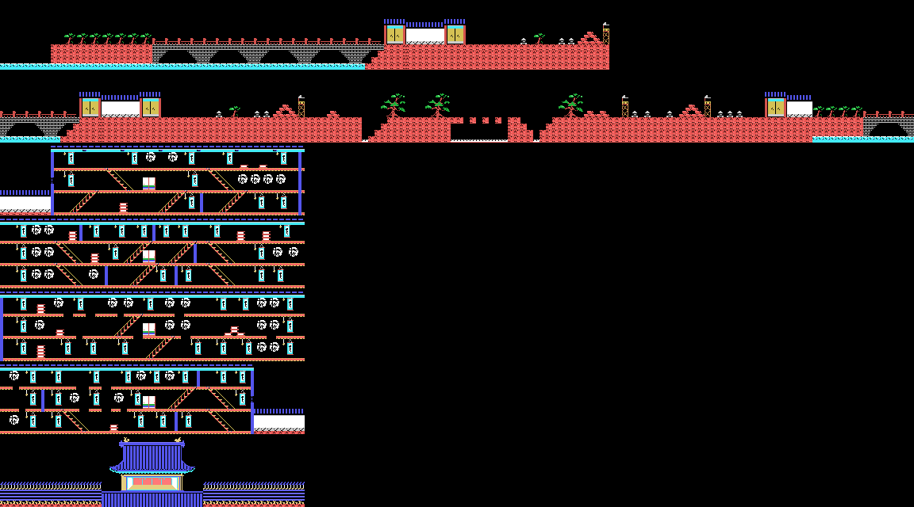

## Stage 0: the bridge

**Ten enemies** must be defeated (the number next to the enemy icon) and the castle gate reached: the ninja walks in by
himself, the gate opens and closes, and 1,000 points (`fase_fin`, 0xA7DE). In the recording with BS, the pilot made it
after 2,500 frames.

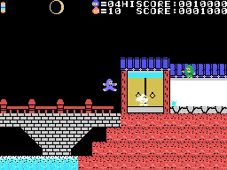

## Stage 1: the courtyard

Reaching the end of the map is enough. There are pits with **spikes** (tile 0x3D): falling on them kills even with BS
held on the title. The pilot with BS fell four times and lost the game on them.

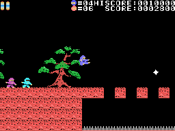

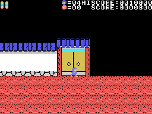

## Stages 2 to 5: the castle

Inside there are stairs, hanging kakejiku and **chests** (tile 0xD4). A chest is opened **by jumping under it**, with
the head: the lid rises in two steps and what is inside appears, at random among eight (`cofre_abre`, 0x9778). From
the sixth chest on, once a random count of 1 to 4 for each stage runs out, the **key** (0x72) comes out. Taking it
opens a gap at a fixed place of the map that holds 0x6E, and taking that opens the exit in three steps: 2,000 points.

| tile | what it does |
|---|---|
| 0x73 | 500 points |
| 0x7E | one more ninja |
| 0x6C | the enemies on screen are defeated |
| 0x6B | power 1: nothing happens when touching an enemy |
| 0xC4 | power 3: walks faster |
| 0xC9 | power 5: the spikes do not kill him |
| 0xCC | power 6: touching an enemy defeats it |
| 0x72 | the key |

The powers last 5 x 256 frames, with the ninja in another colour that flashes at the end (`objeto_cogido`, 0x917D).
They are read from the code; in the forced recording none was taken.

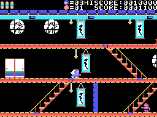

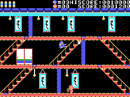

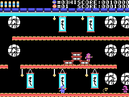

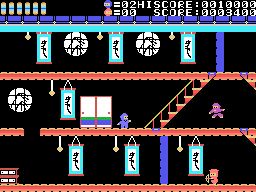

## The enemies

| type | what it is |
|---:|---|
| 0, 1, 3, 6 | ninjas: they come in from one side, walk, jump and throw shuriken (type 6, bullets) |
| 2, 7 | what they throw |
| 4 | a still one on stage 1 that drops things; it takes five shuriken |
| 5, 10 | something that falls towards the ninja |
| 9 | the boss of stage 6 |

The ninjas come out more often the fuller the moon (`enemigos_salen`, 0x9E65).

## Stage 6: the boss

In the tower, the boss goes from side to side and drops things that fall. If it touches the ninja it pushes him and,
very close, kills him; jumping onto it leaves it shaking for a while. It takes **round x 2 + 5 shuriken**: 5 on the
first round, 9 on the third. Beaten, it writes **IGA2** in the window, walks out and gives 3,000 points (`jefe`,
0xA99D). In the forced recording, the pilot beat it by itself on the first round.

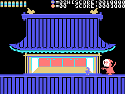

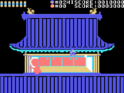

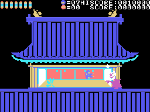
