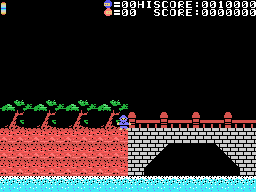
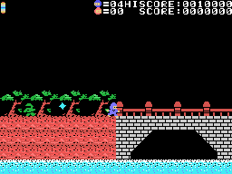

# Curiosidades

## Dos cartuchos a la vez

Nada más encender, el juego mira en todos los slots (los cuatro y los dieciséis expandidos) si en la dirección 0x81B9
hay un 0x21 (`init`, 0x4010). Es el byte que tiene ahí **el primer Iga Ninpouchou**, de 1985, y ninguno de los otros
diez Casio de esta serie desensamblados antes. Si lo encuentra, apunta 0xE060 = 1. En openMSX, con el primer Iga en el segundo slot, 0xE060 se
pone a 1. Lo que cambia:

- **la luna no cambia nunca** (0x8862): en su sitio sale un dibujo fijo (0x890A) y la fase no tiene tiempo;
- en la fase 0 el ninja empieza abajo, a la orilla del río (Y 0xA0, no 0x70);
- y la fase 0 se acaba sin derrotar a diez enemigos: basta con estar a la altura del puente pasada la posición 0x48
  del mapa (0xA7E6). Esto está leído en el código: el piloto de la grabación no llegó.

## Dos teclas en el título

Al acabar la presentación de CASIO, el juego mira las teclas una vez (0x809C):

- **BS** pulsada: 0xE023 = 1, y los enemigos no matan al ninja (`ninja_tocado`, 0x850C). Los pinchos, la luna y el
  jefe muy cerca sí: esas muertes llevan un 2 y no miran BS. En openMSX, con BS, el piloto pasó la fase 0 sin perder
  ninguna vida.
- **2, A, I y G** a la vez: 0xE039 = 2, y sin vidas sale CONTINUE PUSH TRIG1 / END PUSH TRIG2: con el botón 1,
  **dos vidas más** y la fase otra vez, todas las veces que se quiera. En openMSX, dos veces seguidas.

## IGA2

Al vencer al jefe de la fase 6, el juego escribe **IGA2** en la ventana de la torre (0xAC4D): las mismas cuatro
teclas del truco de continuar.

## STOP y F1

Jugando, la interrupción mira dos teclas más (0x8D0B):

- **STOP** para el juego (0xE1B7): el ninja se dibuja con otros sprites (0x5400) y nada se mueve hasta volver a
  pulsarla. Con **C y W** pulsadas a la vez, otros dibujos, que vuelven a los de antes cada 0x60 cuadros.
- **F1**: el ninja cae y se pierde una vida (0xE1B3), como al tocar a un enemigo.

Las dos, comprobadas en openMSX.

## Los colores del título salen de la BIOS

El nombre del juego cambia de colores cada 4 cuadros: cada vez copia 512 bytes **de la ROM del ordenador**, desde
0x3000 y un byte más allá cada vez, y usa la mitad alta de cada uno como color, o 0x60 si es menor de 0x20 (0x8144). Los
colores dependen, por tanto, de la BIOS que tenga el MSX: los del GIF del título son los de C-BIOS, la de openMSX.

## Una vida a los 10.000

A los 10.000 puntos (1.000 por dentro: el 0 del final es fijo) el juego da un ninja más, una sola vez (0x8C2F).

## SCORE está dentro de HISCORE

El marcador escribe "HISCORE:" desde 0x9073 y "SCORE:" desde 0x9075: las seis últimas letras del mismo texto
(`marcador_pon`, 0x87A5).

## Restos de otros programas

- 0x9FD5: el principio de la rutina del kakejiku que se enrolla **del primer Iga Ninpouchou**.
- 0xBFBB: el final de la rutina que pinta la pantalla del primer Iga.
- 0x90D4: un trozo de una rutina de puntos con tope en 999999 y una vida más cuando 0xE00D llega a 0x30,
  que no es la de este juego.

## Código que nadie llama

- 0x9A66 y 0x9B02: subir o bajar la pantalla 8 puntos por paso, de un piso a otro: un desplazamiento vertical que el
  juego no usa.
- 0x8A02: otra forma de abrir la pantalla, desde el centro.
- 0x8930, 0x9C5A, 0x9D63, 0xA049, 0xA0A0, 0xA716 y 0xA78F: trozos de rutinas que ya están en otro sitio.
- 0x8506: un byte que salta un `jr`.

Ninguno se ejecutó en la cobertura medida en openMSX.
