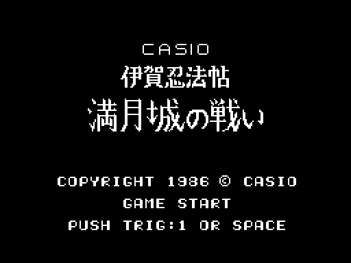
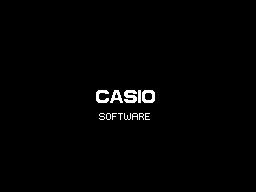
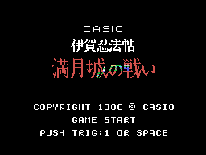
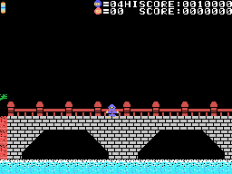
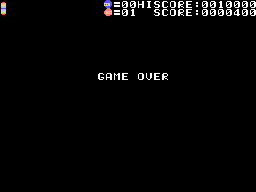

# La partida

*Iga Ninpouchou Mangetsu-jou no Tatakai* (伊賀忍法帖 満月城の戦い, "La batalla del castillo de la luna llena") es un juego
de un ninja de Iga visto de lado. El ninja cruza un puente, entra en el castillo y sube hasta su torre, donde espera
un jefe. Son siete fases y tres vueltas; todo eso, en [Las fases](LAS-FASES.html).

Todos los GIF de esta web son la ROM **funcionando en openMSX** (un MSX1 japonés con C-BIOS, a 60 cuadros por
segundo): en cada cuadro se apuntan la VRAM, la RAM y los registros del VDP, y `tools/vdp.py` los pinta. Los de la
partida son pilotos sencillos escritos para ello (`tools/guiones/`).

## La presentación de CASIO

Dos CASIO entran por los lados y otros dos bajan y suben hacia el centro; al juntarse suena una música corta y sale
SOFTWARE debajo (`presentacion`, 0x8E24).

## El título

CASIO, el nombre en casillas dibujadas, COPYRIGHT 1986 © CASIO, GAME START y PUSH TRIG:1 OR SPACE (`titulo`, 0x808D).
Cada 4 cuadros, los colores del nombre cambian: los saca de la BIOS del ordenador ([Curiosidades](CURIOSIDADES.html)).
Sin botón, a los 240 cuadros empieza la **demostración**, en la fase 0: el juego pulsa los dos botones cada 16 cuadros
y no mueve la palanca, hasta que pierde las cinco vidas.

## Los mandos

| | mando | teclado |
|---|---|---|
| andar, agacharse; las diagonales suben y bajan escaleras | el mando 1 | los cursores |
| tirar el shuriken | el botón 1 | la barra |
| saltar | el botón 2 | GRAPH |

Hay más teclas: BS y 2, A, I y G en el título, y STOP y F1 jugando ([Curiosidades](CURIOSIDADES.html)).

## El shuriken y el salto

Hay **un shuriken** a la vez: sale a la altura del ninja hacia donde mira y va 4 puntos por cuadro hasta el borde
(`shuriken`, 0x9100). El salto sube 24 pasos y baja otros tantos; con la palanca a un lado salta en diagonal, y sin
ella, recto (`salto`, 0x98F3). Tocar a un enemigo en pleno salto en diagonal lo derrota.

## La luna

La luna de arriba del marcador es **el tiempo de la fase** (`luna`, 0x8862). Cada cierto tiempo cambia: crece en cuatro
pasos hasta llena, espera otro paso y mengua en cuatro más. Cuando se acaba, el ninja muere. Cada paso dura 5 veces
240 cuadros en la primera vuelta, 4 en la segunda y 3 en la tercera: unos tres minutos por fase en la primera vuelta y
menos de dos en la tercera (en openMSX, 720 cuadros por paso en la tercera). Con la luna más llena, los enemigos
salen más a menudo.

## Las vidas

La partida empieza con **cinco ninjas**, cuatro de reserva junto al dibujo del ninja. Si toca a un enemigo o lo que
tiran, o cae en los pinchos, el ninja sube y cae y **la fase vuelve a empezar** (`ninja_tocado`, 0x850C): en las fases 0
y 1, desde la pantalla en la que estaba; desde la 2, desde la primera. La RAM de la fase se borra, y con ella los
derrotados y la luna. A los 10.000 puntos, un ninja más, una sola vez. Sin ninjas, GAME OVER (`game_over`,
0x8607).

## El marcador

Arriba: una marca por fase (a la izquierda), la luna, las marcas de 0xE053, el ninja con las vidas, el enemigo con
los derrotados, HISCORE y SCORE (`marcador_pon`, 0x87A5). Como en otros Casio, el marcador pone **un 0 fijo** detrás
de las seis cifras: las cifras de esta web son las de la pantalla.

| | puntos |
|---|---:|
| un ninja enemigo | su tipo x 100: 100, 300 o 600 |
| el enemigo quieto de la fase 1 (cinco shuriken) | 500 |
| el objeto 0x73 | 500 |
| la puerta del castillo (fases 0 y 1) | 1.000 |
| la salida (fases 2 a 5) | 2.000 |
| el jefe | 3.000 |

El récord empieza en 0010000.
