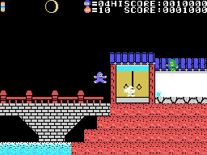
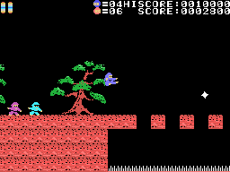
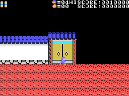
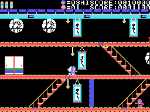
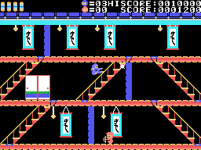
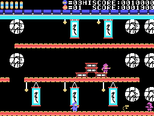
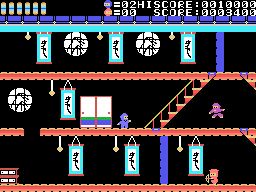
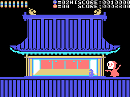
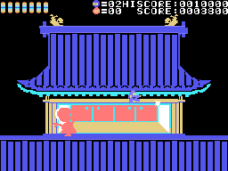
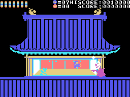

# Las fases

Siete fases (0xE00A, de 0 a 6; tantas marcas a la izquierda del marcador) y **tres vueltas** (0xE009). Después de la
fase 6 de la tercera vuelta, el final: los créditos (STAFF... PRODUCER T.MORIYAMA), la música 5 y el título
(`fase_acabada`, 0x8654). En cada vuelta la luna va más deprisa y, desde la segunda, lo que cae persigue al ninja.

Cada fase es una fila de pantallas (la tabla de 0x406D). El mapa se monta en la RAM con tres pantallas a la vez y
corre de columna en columna cuando el ninja pasa de la mitad ([Por dentro](POR-DENTRO.html)).

Lo grabado sale de tres partidas: una normal, otra con BS pulsada en el título, para que los enemigos no maten al
ninja, y otra **forzada**: con BS y un poke a 0xE186, la fase acabada, cada 1.800 cuadros, para pasar por todas. El
final también está forzado: se pone la fase 6 de la tercera vuelta y, al cabo de 9.000 cuadros sin vencer al jefe,
otra vez el poke.

| fase | dónde | cómo se acaba |
|---:|---|---|
| 0 | el puente | con 10 enemigos derrotados, la puerta del castillo |
| 1 | el patio | al final del mapa, la puerta del castillo |
| 2-5 | dentro del castillo y el tejado | la llave de un cofre abre un hueco; lo de dentro (0x6E) abre la salida |
| 6 | la torre | vencer al jefe |

## La fase 0: el puente

Hay que derrotar a **diez enemigos** (el número junto al dibujo del enemigo) y llegar a la puerta del castillo: el
ninja entra solo, la puerta se abre y se cierra, y 1.000 puntos (`fase_fin`, 0xA7DE). En la grabación con BS, el
piloto lo consiguió a los 2.500 cuadros.

## La fase 1: el patio

Basta con llegar al final del mapa. Hay fosos con **pinchos** (la casilla 0x3D): caer en ellos mata aunque BS esté
pulsada en el título. El piloto con BS cayó cuatro veces y perdió la partida en ellos.

## Las fases 2 a 5: el castillo

Dentro hay escaleras, kakejiku colgados y **cofres** (la casilla 0xD4). Un cofre se abre **saltando debajo**, con la
cabeza: la tapa se levanta en dos pasos y aparece lo de dentro, al azar entre ocho (`cofre_abre`, 0x9778). Desde el
sexto cofre, y cuando se acaba una cuenta al azar de 1 a 4 de cada fase, sale la **llave** (0x72). Cogerla abre un
hueco en un sitio fijo del mapa que guarda el 0x6E, y cogerlo abre la salida en tres pasos: 2.000 puntos.

| casilla | qué hace |
|---|---|
| 0x73 | 500 puntos |
| 0x7E | un ninja más |
| 0x6C | los enemigos de la pantalla quedan derrotados |
| 0x6B | el poder 1: no le pasa nada al tocar a un enemigo |
| 0xC4 | el poder 3: anda más deprisa |
| 0xC9 | el poder 5: los pinchos no lo matan |
| 0xCC | el poder 6: tocar a un enemigo lo derrota |
| 0x72 | la llave |

Los poderes duran 5 x 256 cuadros, con el ninja de otro color que parpadea al final (`objeto_cogido`, 0x917D). Están
leídos en el código; en la grabación forzada no se cogió ninguno.

## Los enemigos

| tipo | qué es |
|---:|---|
| 0, 1, 3, 6 | ninjas: entran por un lado, andan, saltan y tiran shuriken (el 6, balas) |
| 2, 7 | lo que tiran |
| 4 | uno quieto de la fase 1 que suelta cosas; aguanta cinco shuriken |
| 5, 10 | algo que cae hacia el ninja |
| 9 | el jefe de la fase 6 |

Los ninjas salen más a menudo con la luna más llena (`enemigos_salen`, 0x9E65).

## La fase 6: el jefe

En la torre, el jefe va de un lado a otro y suelta cosas que caen. Si toca al ninja lo empuja y, muy cerca, lo mata;
saltarle encima lo deja temblando un rato. Aguanta **vuelta x 2 + 5 shuriken**: 5 en la primera vuelta, 9 en la
tercera. Vencido, escribe **IGA2** en la ventana, sale andando y da 3.000 puntos (`jefe`, 0xA99D). En la grabación
forzada, el piloto lo venció solo en la primera vuelta.

