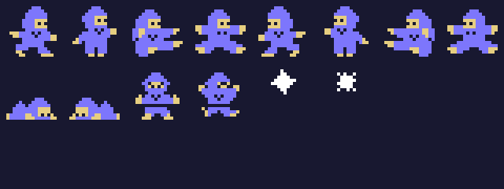
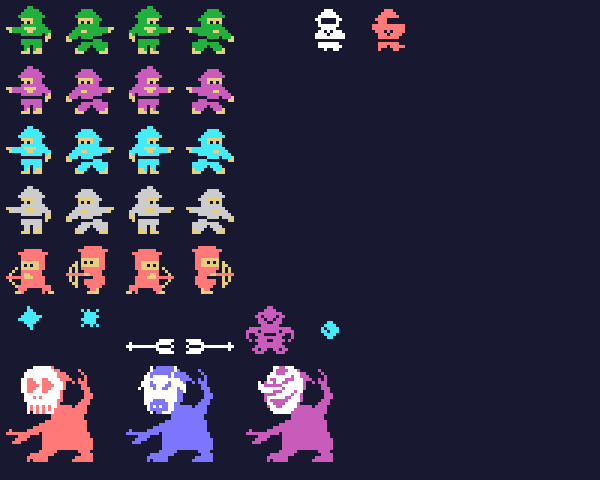
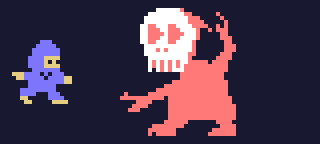

# Los sprites

Todo lo de esta página está **montado desde las tablas de la ROM** con `tools/hojas.py`: los dibujos son los 0x800
bytes de 0x5800 que `sprites_dibujos` pone tal cual en 0x3800, y cada figura se arma con los dibujos, los colores y
los sitios que le da su propia rutina. Cada cosa son sprites de 16 bytes en 0xE300 (los 4 primeros, sus atributos):
el ninja en 0xE300 y 0xE310, su shuriken en 0xE320 y los demás desde 0xE330. Ninguna de estas imágenes es una
captura.

**Cotejado con openMSX** en las grabaciones de esta web:

- la tabla de dibujos de los sprites (VRAM 0x3800-0x3FFF) es **idéntica** a la del juego en 102.952 cuadros (otros
  7 pillan la copia a medias);
- los dos sprites del ninja casan en 76.679 cuadros (otros 432 aún están a cero al empezar una fase); **3 sin
  explicar**;
- los ninja enemigos (los tipos 1, 3 y 6 y el hueco siguiente) en 60.362 cuadros; **9 sin explicar**;
- el jefe en 12.491 cuadros, y aturdido temblando (o saliendo aún sin dibujo) en 153; **0 distintos**.

## El ninja

Dos sprites en el mismo sitio: el dibujo en azul claro (5) y el dibujo + 4 en amarillo claro (11) (`fase_empieza`,
0x829E). Mirando a la derecha 0x28 o 0x30 (de pie, según la columna del mapa; andando, el paso cada 8 cuadros),
mirando a la izquierda 0x00 o 0x08 (`ninja_dibujo`, 0x973F); saltando 0x38 y 0x10 y cayendo 0x40 y 0x18 (0x9701);
después agachado (0x48 a la derecha, 0x20 a la izquierda, 0x96EF) y tocado (0x88 y 0x90, 0x8570); y su shuriken
(0xA4 y 0xA8, blanco):

## Los enemigos

Los ninja enemigos son también dos sprites: 0x50 mirando a la izquierda o 0x60 a la derecha (`ninja_enemigo_dibujo`,
0xA215), + 8 con el paso, en su color, y el dibujo + 4 en amarillo claro (`ninja_enemigo_color`, 0xA151). El tipo 1
es verde oscuro en la fase 0 y magenta después; el tipo 3, cian en la fase 1 y gris después; el tipo 6, rojo claro,
con arco y sus propios dibujos (0xC0 y 0xD0). Derribados, 0x88 y 0x90, los mismos que el ninja tocado. Después lo que
tiran (los tipos 2 y 7, `tiro_enemigo`: las estrellas 0xA4 y 0xA8 en cian, las flechas 0x78 y 0x7C en blanco), el
tipo 4 (0x70, magenta, `enemigo4`) y lo que cae (los tipos 5 y 10, 0x9C en cian, `cae_enemigo`). Abajo, el jefe de
la fase 6 (`jefe`, 0xA99D): cinco sprites, la cabeza (0xAC, 0xB8 o 0xBC según la vuelta, en blanco) 4 puntos a la
derecha del cuerpo, dos por dos en el color de la vuelta (rojo claro, azul claro o magenta), que cambia entre
0xF0-0xFC y 0xE0-0xEC cada 8 cuadros (`jefe_dibujo`, 0xAC0F):

El ninja andando y el jefe moviéndose, al ritmo del juego:

